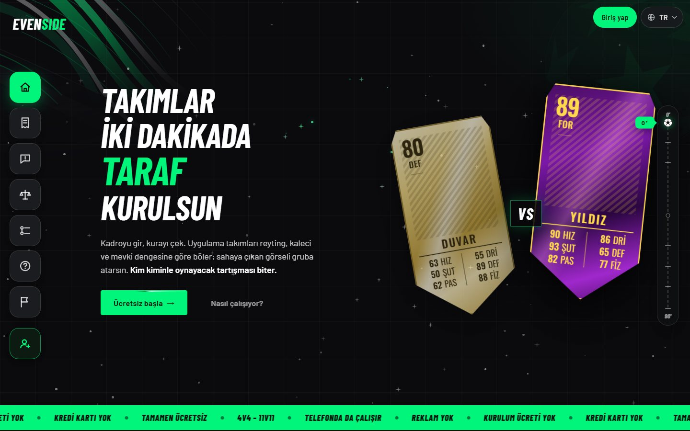
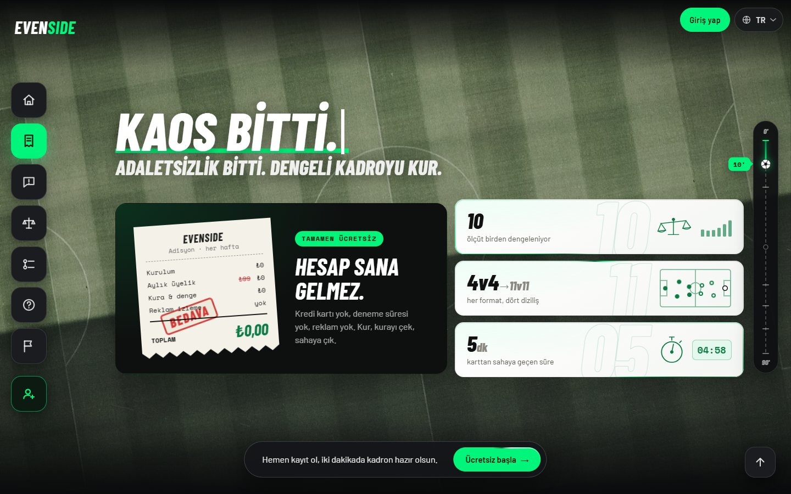
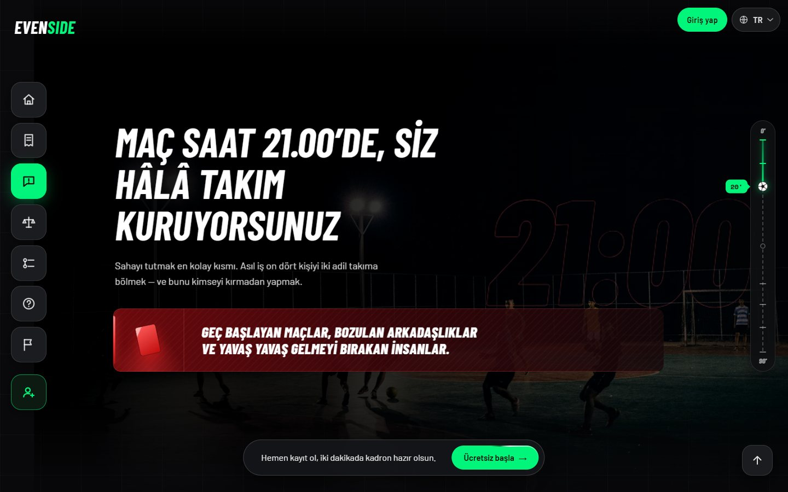
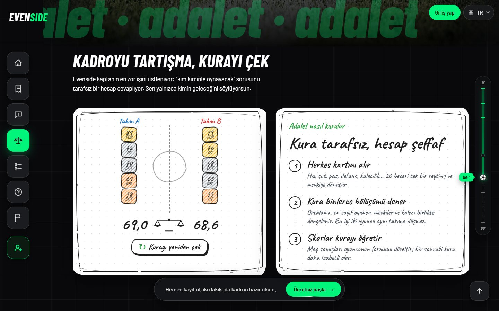
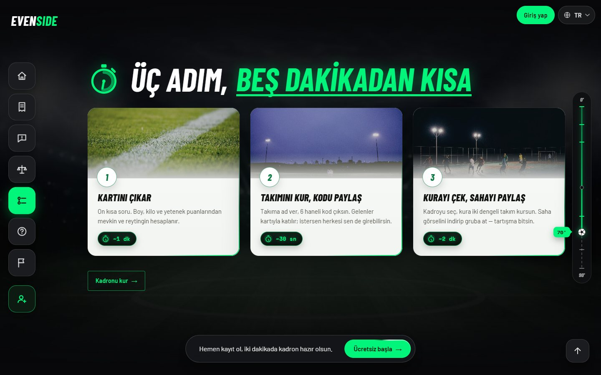
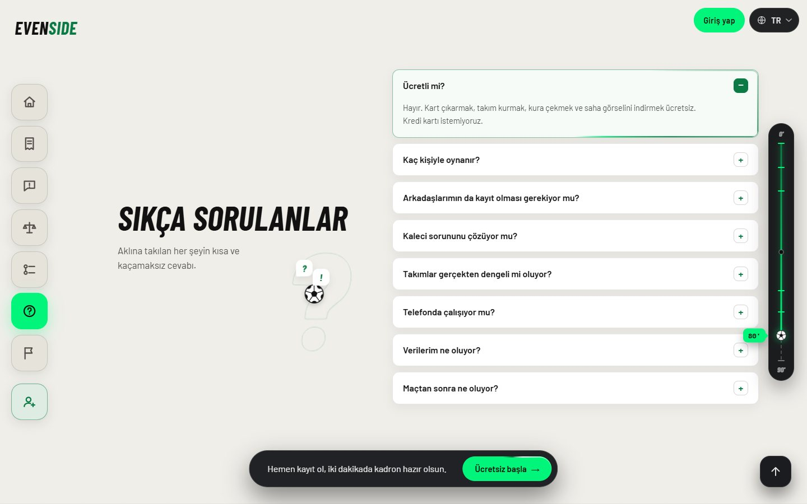
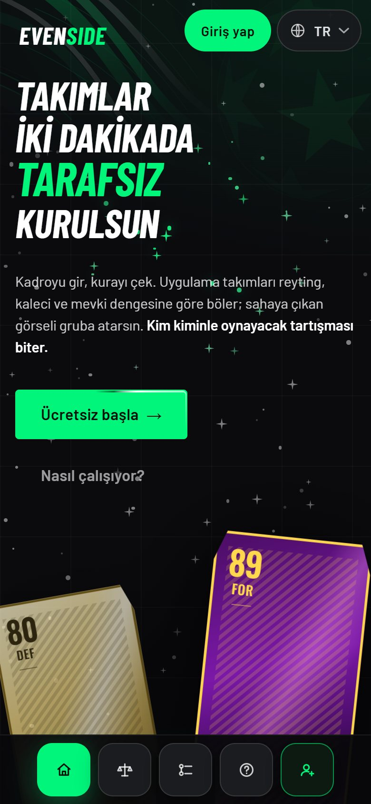
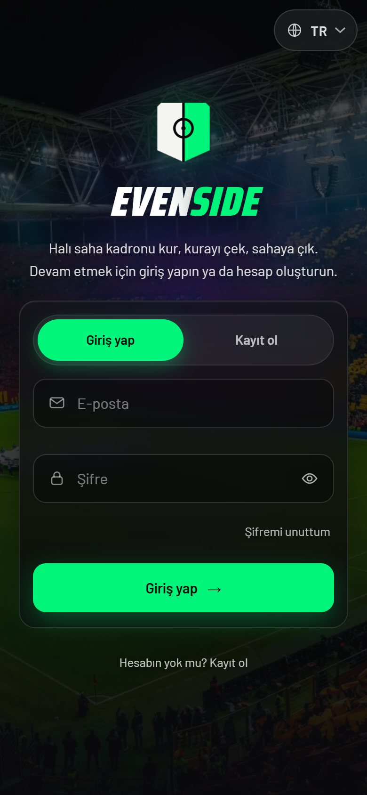

<div align="center">

# Evenside

**Halı saha maçları için kadro kurma ve adil takım kurası.**

Kartını çıkar, takımını kur, kurayı çek — takımlar iki dakikada tarafsız kurulsun.

[**evenside.pages.dev**](https://evenside.pages.dev)



</div>

## Neler yapıyor?

- **Oyuncu kartı** — boy, kilo ve 20 beceriden FIFA tarzı bir kart: reyting, mevki ve altı istatistik.
- **Adil kura** — reyting, kaleci, zayıf halka ve mevki dengesini birlikte gözeten takım bölüşümü; en iyi iki oyuncu aynı takıma düşmez.
- **Kura töreni** — oyuncular düşükten yükseğe, walkout tarzı animasyonla açılır.
- **Saha görünümü** — dizilişi seç, oyuncuları takas et, saha görselini indirip gruba at.
- **Takım kodu** — arkadaşların 6 haneli kodla kendi kartlarıyla takıma katılır.
- **Skorlar kurayı öğretir** — girilen maç sonuçları oyuncunun formunu düzeltir, bir sonraki kura daha isabetli olur.
- **4v4'ten 11v11'e**, altı dil (Türkçe, İngilizce, Almanca, Fransızca, İspanyolca, Arapça), telefonda da çalışır.

## Ekranlar

<table>
  <tr>
    <td></td>
    <td></td>
  </tr>
  <tr>
    <td></td>
    <td></td>
  </tr>
  <tr>
    <td colspan="2"></td>
  </tr>
</table>

### Telefonda

<p align="center">
  
  &nbsp;&nbsp;
  
</p>

## Teknoloji

- [Angular 22](https://angular.dev) — standalone bileşenler, signals, `OnPush`; harici UI kütüphanesi yok
- [Supabase](https://supabase.com) — kimlik doğrulama, Postgres + RLS, gerçek zamanlı oyuncu havuzu
- [Cloudflare Pages](https://pages.cloudflare.com) — barındırma
- MediaPipe — fotoğraftan arka plan silme, tamamen tarayıcıda

## Geliştirme

```bash
cd app
npm install
npx ng serve        # http://localhost:4200
npx ng test --watch=false --browsers=ChromeHeadless
npm run yayinla     # derle + sızıntı taraması + Cloudflare Pages
```

Kurulum ayrıntıları ve Supabase şeması: [`app/README.md`](app/README.md).
